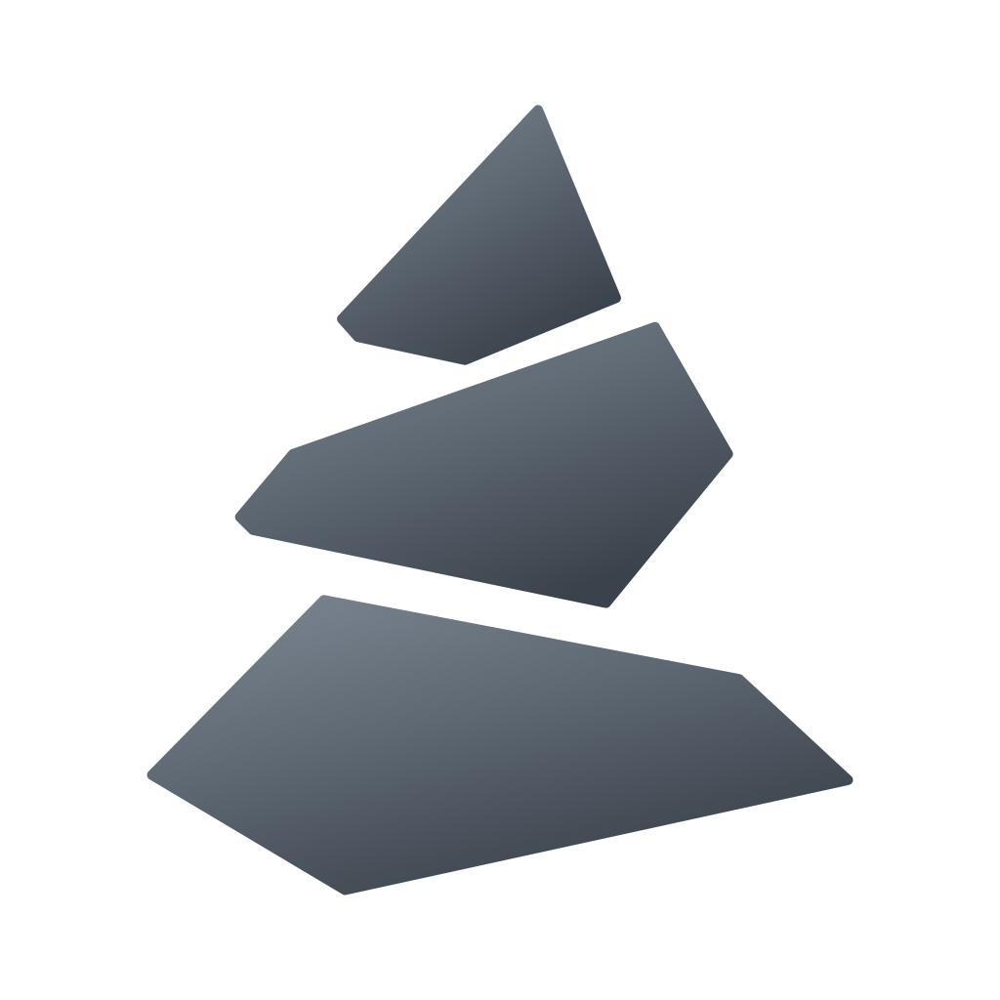

<h1 align="center">Slate</h1>

<strong>Notes that feel like Notion and stay yours like Obsidian — free, private, and on all your devices.</strong>

<a href="https://cairnnote.netlify.app"><strong>Open Slate →</strong></a>

---

## Do I need to download anything?

**No.** Slate is a web app: there's nothing to download, no App Store, no account and no payment. Open the link
above and you can start writing straight away. If you want it to feel like a real app — its own icon in the Dock
or on your Home Screen, its own window, and working with no internet — "install" it from your browser. It takes
about ten seconds and you can remove it like any other app.

## Install it

### On a Mac (Safari)

1. Open **<https://cairnnote.netlify.app>** in Safari.
2. In the menu bar, choose **File → Add to Dock…**, then click **Add**.
3. Slate now opens from your Dock, Launchpad and Spotlight in its own window.

**Optional — a see-through Dock icon:** Safari puts web-app icons on a white square. On macOS 26 or later you can
swap in a glass icon that matches your Dock: download this repo (green **Code** button → **Download ZIP**), unzip
it, and double-click `mac/apply-dock-icon.command`. If macOS says it can't verify it, open **System Settings →
Privacy & Security**, scroll down and click **Open Anyway**. Run it again if you ever remove Slate from the Dock and add it back.

*Using Chrome or Edge instead?* Click the install icon at the right end of the address bar.

### On an iPhone or iPad (Safari)

1. Open **<https://cairnnote.netlify.app>** in Safari.
2. Tap **Share** (on newer iOS it's inside the **•••** menu), then **Add to Home Screen**.
3. Keep **Open as Web App** on and tap **Add**.

### On Android, Windows, Linux or a Chromebook

Open the link in Chrome or Edge and choose **Install app** (or **Add to Home screen**) from the browser menu.

### Updating

There's nothing to do: when a new version is out, Slate shows **"A new version of Slate is ready"** — tap
**Update**.

## Get your notes on every device (optional)

Out of the box your notes live only on the device you write them on. To have your Mac and phone match, Slate
syncs with a free **private** GitHub repository that you own:

1. Make a free account at <https://github.com> if you don't have one.
2. In Slate, open **Settings → Sync** and follow the steps there (about two minutes). They walk you through
   making a private repo called `cairn-notes` and a token that can only touch that one repo.
3. Do **Settings → Sync** once on each device, with the same repo.

After that, notes save instantly and sync by themselves. Every page is a normal Markdown file in your repo, so
you can also open them in Obsidian or any text editor.

## What you get

- **A Notion-style editor** — type `/` for headings, to-dos, toggles, callouts, tables and code; drag blocks with
  the ⠿ handle; select text for the formatting bar.
- **Turn lines into…** — paste a list of steps (or highlight some lines) and turn them into bullets, numbers,
  to-dos or a toggle in one click. A bold line like **Setup** becomes the toggle's title.
- **Today on Home** — the times in today's note and what's due, in one list (plus Google Calendar events where
  that's switched on).
- **Tasks** — every to-do from every page, sorted into Overdue, Today, Upcoming. Add a date with `📅 2026-10-20`.
- **Templates, properties and tables** — reusable page layouts, Notion-style properties, and any folder as a table.
- **Version history** — see and restore earlier versions of a page (with sync on).
- **Encrypted pages** — lock any page or folder with a passphrase, and unlock it with Face ID or Touch ID.
- **Links and graph** — `[[link]]` between pages, backlinks, and a graph of how your notes connect.
- **Your own icons** — emoji, or make one from shapes, colours, letters or a pixel drawing, for pages and folders.
- **Themes** — light and dark, six colour palettes, any accent colour, four fonts.

## Is it private?

Yes. Slate has **no server, no accounts and no analytics**. Your notes are stored in your own browser and, if you
turn on sync, in your own private GitHub repo — nobody else can see them, including whoever runs the website. The
site is locked so it can only talk to GitHub (and Google Calendar, if you connect it). Full details are on the
[privacy page](https://cairnnote.netlify.app/privacy.html).

## Questions

**Does it cost anything?** No. Slate, the website and GitHub sync are all free.

**Is it in the App Store?** Not yet — installing from Safari gives you the same app for free, and it never expires.

**What happens if I delete the app?** On a device without sync, its notes go with it (like any app). With sync on,
everything is still in your GitHub repo — install again, connect the same repo, and it all comes back.

**Something's broken or missing?** Open an [issue](https://github.com/ProffesorDiggamore/Cairn/issues).

---

Want to run your own copy, turn on Google Calendar for your site, or work on the code? See the
[developer guide](app/README.md).
